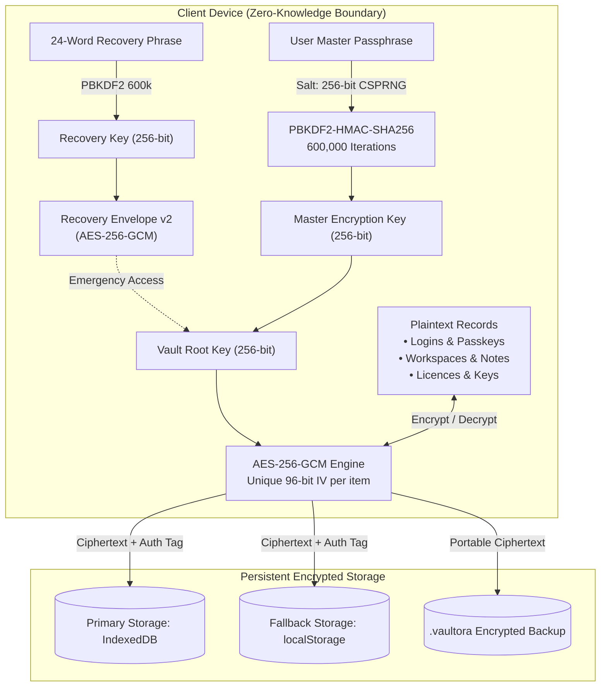

<div align="center">


# Vaultora — Secure Digital Workspace & Vault

**Privacy-First Zero-Knowledge Password Manager, Client Workspace Organizer & Encrypted Digital Locker**

[](https://github.com/aniketak159-hub/Vaultora---Secure-Digital-Workspace-Vault/releases)
[-00d6a0.svg?style=flat-square&logo=android&logoColor=white)](public/downloads/vaultora-production-v1.0.7.apk)
[](android/AndroidManifest.xml)
[](src/crypto/cryptoService.ts)
[](src/crypto/cryptoService.ts)
[](package.json)
[](package.json)

<p align="center">
  <a href="#-overview">Overview</a> •
  <a href="#-key-features">Key Features</a> •
  <a href="#-security-architecture">Security Architecture</a> •
  <a href="#-android-production-release">Android Release</a> •
  <a href="#-quickstart--local-development">Quickstart</a> •
  <a href="#-automated-verification--testing">Testing</a> •
  <a href="#-troubleshooting">Troubleshooting</a>
</p>

---

</div>

## 📌 Overview

**Vaultora** is an encrypted digital vault and credential management suite engineered from first principles for security and privacy. Designed specifically for **freelancers, digital agencies, and security-conscious individuals**, Vaultora solves credential fragmentation by unifying login credentials, API secrets, client environments, software licenses, and private recovery notes into a single zero-knowledge architecture.

All cryptographic derivation and payload encryption happen strictly client-side on your local device before touching persistent storage. The master passphrase never leaves your device memory, and server or cloud storage providers have zero access to your plaintext records.

```
Client Device (Browser / Android WebAPK)
  │
  ├─► Master Passphrase + Salt (256-bit cryptographically secure)
  │     └─► PBKDF2-HMAC-SHA256 (600,000 iterations) ──► Master Key (256-bit)
  │
  ├─► Emergency Recovery Phrase (24 Words)
  │     └─► Recovery Envelope v2 (AES-256-GCM) ──► Vault Root Key (256-bit)
  │
  └─► Local Encrypted Vault (AES-256-GCM) ──► Dual-Layer Local Storage (IndexedDB + localStorage)
```

---

## ⚡ Key Features

### 🛡️ Zero-Knowledge Cryptography
- **AES-256-GCM Authenticated Encryption:** Every item and backup archive is protected with 256-bit keys and unique 96-bit initialization vectors (IVs) with cryptographic authentication tags to prevent data tampering.
- **Hardened Key Derivation:** Master key derived via **PBKDF2-HMAC-SHA256** using **600,000 iterations** and a 256-bit CSPRNG salt.
- **24-Word Emergency Recovery Kit:** Full disaster recovery using BIP-39 compatible wordlists and `vaultora_recovery_envelope_v2` wrapping the 256-bit vault root key.
- **Ephemeral Key Lifecycle:** Decrypted credentials exist only in volatile component memory and are zeroed on vault lock or session timeout.

### 💼 Client-Centric Workspaces
- Tailored for freelancers and agencies juggling multiple client environments.
- Segregate credentials by workspace (e.g., *Acme Corp*, *Starlight Agency*, *Personal*).
- Tag items across hosting, domains, DNS, advertising platforms, API keys, and databases without mixing client boundaries.

### 🔍 Security Health & Breach Intelligence
- **k-Anonymity Compromised Credential Detection:** Real-time breach auditing using SHA-1 prefix matching against known breach databases (HaveIBeenPwned API model) without exposing plaintext passwords.
- **Password Strength Auditing:** Granular entropy scoring detecting weak, reused, or stale credentials.
- **Security Audit Trail:** Immutable client-side log tracking unlocks, credential reveals, export generation, and vault modifications.

### 📦 Encrypted Backups & Portability
- Export and import password-protected `.vaultora` archives.
- Format versioning with cryptographic envelope verification before applying restores.
- Safe rollback protection ensuring corrupted archives cannot overwrite existing vaults.

### 📱 Hardened Android Application (`io.vaultora.app`)
- **FLAG_SECURE Active:** Operating system-level defense blocking screenshots, screen recording, and task switcher snapshots.
- **Biometric Authentication:** Hardware-backed fingerprint and facial recognition unlocking via Android `BiometricPrompt`.
- **Fully Offline Self-Contained:** Packaged standalone WebAPK with local asset routing—zero external cloud dependency required.

---

## 🔐 Security Architecture

Vaultora enforces a strict cryptographic boundary separating authentication, key derivation, and storage:



### Cryptographic Parameters Summary

| Component | Standard / Algorithm | Parameters |
| :--- | :--- | :--- |
| **Symmetric Cipher** | AES-GCM (NIST SP 800-38D) | 256-bit key, 96-bit IV, 128-bit authentication tag |
| **Passphrase KDF** | PBKDF2-HMAC-SHA256 | 600,000 iterations, 32-byte salt (RFC 8018) |
| **Emergency Recovery** | BIP-39 mnemonic phrase | 24 words (256 bits entropy), envelope v2 |
| **Breach Audit** | k-Anonymity SHA-1 prefix | 5-character prefix search, full hash never transmitted |
| **Randomness** | `crypto.getRandomValues()` | Cryptographically Secure Pseudorandom Number Generator |

---

## 📱 Android Production Release

The official Android package is distributed as an aligned, cryptographically signed standalone APK.

| Specification | Target Details |
| :--- | :--- |
| **Package Name** | `io.vaultora.app` |
| **Application Version** | `1.0.7` (`versionCode`: `7`) |
| **Minimum SDK** | Android 7.0 (API 24) |
| **Target SDK** | Android 14 (API 34) |
| **APK Binary** | [`vaultora-production-v1.0.7.apk`](public/downloads/vaultora-production-v1.0.7.apk) |
| **File Size** | `776,148 bytes` (~758 KB) |
| **SHA-256 Checksum** | `627551fd134848210be17b3d045b1e736454077c91f79720c8a018c71ae25ab1` |
| **Signing Schemes** | v1 (JAR), v2 (APK Signature Scheme), v3 (Android 9+) |
| **Alignment** | 4-byte boundary verified via `zipalign -c -v 4` |

### Installing via ADB
```bash
# Connect device via USB debugging and install
adb install -r public/downloads/vaultora-production-v1.0.7.apk

# Verify signature validity independently
apksigner verify --verbose public/downloads/vaultora-production-v1.0.7.apk
```

---

## 🚀 Quickstart & Local Development

### Prerequisites
- Node.js `20.x` or higher
- npm `10.x` or higher

### 1. Clone the repository
```bash
git clone https://github.com/aniketak159-hub/Vaultora---Secure-Digital-Workspace-Vault.git
cd Vaultora---Secure-Digital-Workspace-Vault
```

### 2. Install dependencies
```bash
npm install
```

### 3. Start development server
```bash
npm run dev
```
Open [http://localhost:3000](http://localhost:3000) in your browser.

### 4. Build web production bundle
```bash
npm run build
```

---

## 🧪 Automated Verification & Testing

Vaultora includes automated test suites covering cryptographic operations, storage failover, and emergency disaster recovery:

```bash
# Execute storage persistence & migration scenarios (13 test cases)
npx tsx scripts/test-persistence-scenarios.ts

# Execute full emergency recovery phrase E2E lifecycle (11 test cases)
npx tsx scripts/test-recovery-e2e.ts

# Verify Android APK binary alignment and digital signatures
python3 scripts/verify-apk-deep.py
```

---

## 🔧 Troubleshooting

### Why is the preview showing an old or different project ("CloudMount") instead of Vaultora?
If you recently worked on another application (such as CloudMount or Stratus) on this host or preview origin, your browser may have cached the previous Progressive Web App shell or registered a Service Worker.

**How to resolve in 5 seconds:**
1. **Hard Refresh:** Press `Ctrl + F5` (Windows/Linux) or `Cmd + Shift + R` (macOS).
2. **Clear Service Worker:**
   - Open Developer Tools (`F12` or `Ctrl + Shift + I`).
   - Navigate to the **Application** tab.
   - Click **Service Workers** in the left sidebar.
   - Click **Unregister** on any active service workers, then reload the page.
   - In **Storage**, click **Clear site data**.

### "App not installed as package appears to be invalid" on Android
If upgrading from an earlier development build:
1. Ensure you are using `vaultora-production-v1.0.7.apk` which includes full v1/v2/v3 signatures and 4-byte zip alignment.
2. If an older test APK was signed with a debug certificate, uninstall the existing app first before installing the official production release:
   ```bash
   adb uninstall io.vaultora.app
   adb install public/downloads/vaultora-production-v1.0.7.apk
   ```

---

## 🛡️ Security Disclosures

We take the security of Vaultora seriously. If you discover a potential vulnerability or cryptographic weakness, please report it privately:

- **Email:** `security@vaultora.io` (or contact the repository maintainer directly via GitHub)
- Please do not file public GitHub issues for security vulnerabilities.
- Provide a detailed reproduction report so our team can remediate the issue promptly.

---

## 📄 License

This repository does not currently include a public open-source license. All rights are reserved by the original author and contributors until an official license is declared.
