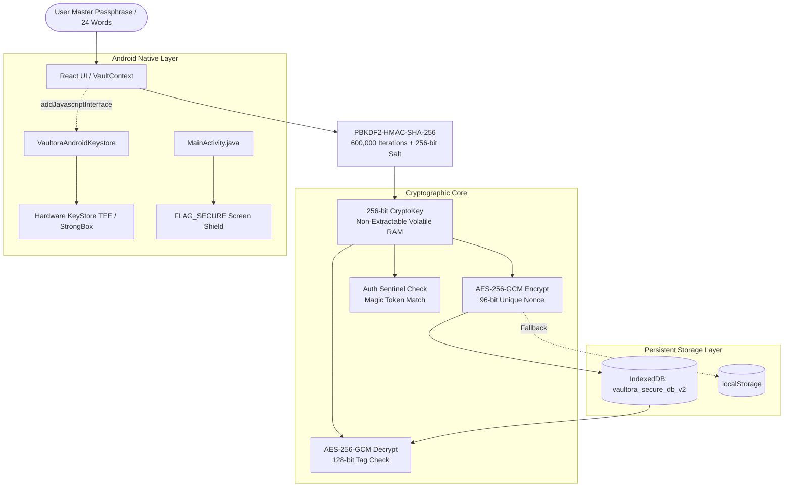

# Developer Documentation — Vaultora

**Product:** Vaultora — Secure Digital Workspace & Vault  
**Repository:** [aniketak159-hub/Vaultora---Secure-Digital-Workspace-Vault](https://github.com/aniketak159-hub/Vaultora---Secure-Digital-Workspace-Vault)  
**Android Package:** `io.vaultora.app`  
**Current Release:** v1.0.7 (VersionCode: 7)  
**Target Environment:** Web (PWA), Android (Native WebView Shell with Android KeyStore Bridge)

---

## Table of Contents

1. [Project Overview](#1-project-overview)
2. [Technology Stack](#2-technology-stack)
3. [Prerequisites](#3-prerequisites)
4. [Local Development Setup](#4-local-development-setup)
5. [Project Structure](#5-project-structure)
6. [Application Architecture](#6-application-architecture)
7. [Android Development & APK Packaging](#7-android-development--apk-packaging)
8. [Configuration & Secrets Management](#8-configuration--secrets-management)
9. [Testing & Quality Assurance](#9-testing--quality-assurance)
10. [Safe Contribution Guidelines](#10-safe-contribution-guidelines)
11. [Troubleshooting & Debugging](#11-troubleshooting--debugging)

---

## 1. Project Overview

**Vaultora** is an offline-capable, privacy-first credential manager and encrypted digital workspace. Engineered specifically for developers, freelancers, and digital agencies managing credentials across multiple client environments, Vaultora eliminates credential fragmentation while enforcing strict **client-side zero-knowledge encryption**.

### Core Technical Pillars

* **Client-Side Cryptographic Execution:** All cryptographic operations—including key derivation, symmetric payload encryption, auth sentinel verification, and envelope unsealing—execute 100% locally within the browser Web Crypto API runtime (`window.crypto.subtle`) or via the Android KeyStore bridge.
* **Dual-Target Distribution:** The repository compiles to a modern Progressive Web Application (PWA) with offline Service Workers and a standalone signed Android APK (`io.vaultora.app`) equipped with OS-level `FLAG_SECURE` window shielding and native KeyStore bindings.
* **Workspace Isolation:** Vault entries are categorized into distinct client workspaces (e.g., Client Projects, Internal Operations, Personal Vault) with localized tagging, audit logging, and bulk export capabilities.

---

## 2. Technology Stack

### Web Application Frontend

| Layer | Technology | Version | Purpose |
| :--- | :--- | :--- | :--- |
| **Runtime / Language** | TypeScript | `^7.0.2` | Type-safe implementation across all components and crypto services |
| **UI Framework** | React | `^19.0.1` | Component-based UI with hooks and functional state architecture |
| **Styling** | Tailwind CSS | `^4.3.3` | Utility-first styling via `@tailwindcss/vite` |
| **Motion & Animation** | Motion (Framer Motion) | `^12.23.24` | Startup branding animation and modal transitions |
| **Iconography** | Lucide React | `^0.546.0` | Accessible SVG security and interface icons |
| **Build Tooling** | Vite | `^8.3.0` | High-performance bundler and dev server |
| **PWA Engine** | Vite Plugin PWA (Workbox) | `^2.0.0` | Offline caching, web app manifest, and Service Worker lifecycle |

### Cryptographic & Storage Primitives

| Component | Standard / API | Parameters | Verified File |
| :--- | :--- | :--- | :--- |
| **Web Crypto API** | W3C `SubtleCrypto` | Standard browser cryptographic engine | `/src/crypto/cryptoService.ts` |
| **Symmetric Encryption** | AES-256-GCM | 256-bit key, 96-bit unique IV, 128-bit MAC tag | `/src/crypto/cryptoService.ts` |
| **Key Derivation (KDF)** | PBKDF2-HMAC-SHA-256 | **600,000 iterations**, 256-bit random salt | `/src/crypto/cryptoService.ts` |
| **Emergency Recovery** | BIP-39 English Wordlist | 24 words, sealed envelope (`vaultora_recovery_envelope_v2`) | `/src/crypto/cryptoService.ts` |
| **Storage Engine** | IndexedDB (`vaultora_secure_db_v2`) | Primary asynchronous encrypted storage with `localStorage` fallback | `/src/crypto/secureStorage.ts` |

### Android Platform & Tooling

| Component | Tool / Version | Purpose |
| :--- | :--- | :--- |
| **Application ID** | `io.vaultora.app` | Unique Android package identifier |
| **SDK Levels** | Min SDK: 24 (Android 7.0) / Target SDK: 34 (Android 14) | Operating system compatibility range |
| **Packaging Pipeline** | Python 3 (`scripts/build-fresh-apk.py`) | Automated standalone APK builder with binary manifest patching |
| **Android Build Tools** | `aapt`, `zipalign`, `jarsigner`, `apksigner` | Official Google tools for alignment and v1/v2/v3 multi-scheme signing |
| **Native Integration** | Java (`MainActivity.java`) | Hardened WebView, `FLAG_SECURE`, and `VaultoraAndroidKeystore` bridge |

---

## 3. Prerequisites

Before setting up the Vaultora development environment, verify that your machine meets the following requirements:

### Required Software

1. **Node.js:** `v18.0.0` or higher (Recommended: `v20.x` or `v22.x LTS`).
2. **Package Manager:** `npm` (`v9.x` or higher) bundled with Node.js.
3. **Python 3:** `v3.8` or higher (Required for Android APK build scripts in `scripts/`).

### Optional (Required only for Android APK Building & Verification)

* **Java Development Kit (JDK):** OpenJDK 11 or 17 (Provides `javac`, `jar`, `keytool`, `jarsigner`).
* **Android SDK Build-Tools:** Version 30+ (Provides `aapt`, `zipalign`, `apksigner`).
* **Android Debug Bridge (`adb`):** For sideloading and device testing.

---

## 4. Local Development Setup

### 4.1 Clone Repository & Install Dependencies

```bash
# Clone the repository
git clone https://github.com/aniketak159-hub/Vaultora---Secure-Digital-Workspace-Vault.git
cd Vaultora---Secure-Digital-Workspace-Vault

# Install dependencies exactly as declared in package.json
npm install
```

### 4.2 Configure Environment Variables

The web application runs 100% client-side and does not require third-party API keys for core password management. For extended AI assistant features (optional), copy the example configuration:

```bash
cp .env.example .env
```

Review `.env.example`:
```ini
# GEMINI_API_KEY: Optional server-side or runtime key for Gemini assistant drawer
GEMINI_API_KEY=""

# APP_URL: Base host URL used for self-referential links (defaults to current origin)
APP_URL="http://localhost:3000"
```

### 4.3 Start Development Server

```bash
npm run dev
```

The Vite dev server will start at:
* **Local:** `http://localhost:3000`
* **Network:** `http://0.0.0.0:3000`

### 4.4 Build Production Web Bundle

```bash
npm run build
```

This compiles optimized assets to `/dist` and updates the offline PWA service worker manifest.

---

## 5. Project Structure

```
├── .env.example                     # Example environment variable template
├── .gitignore                       # Git ignore list (node_modules, dist, .env*)
├── index.html                       # HTML5 entry point with strict CSP & typography
├── metadata.json                    # Application metadata and runtime permissions
├── package.json                     # NPM dependency and script definitions
├── tsconfig.json                    # TypeScript compiler configuration (ES2022, bundler)
├── vite.config.ts                   # Vite configuration with Tailwind v4, PWA & APK routing
│
├── src/                             # Main application source code
│   ├── App.tsx                      # Primary layout orchestrator and modal mounts
│   ├── main.tsx                     # React DOM entry point
│   ├── index.css                    # Global Tailwind CSS entry point
│   │
│   ├── components/                  # Modular React UI components
│   │   ├── ai/                      # Optional AI Workspace assistant drawer
│   │   ├── android/                 # In-app Android APK download modal
│   │   ├── common/                  # Reusable confirmation dialogs
│   │   ├── dashboard/               # Overview metrics and recent activity
│   │   ├── extension/               # Browser extension simulation drawer
│   │   ├── generator/               # Entropy-based password & passphrase generator
│   │   ├── layout/                  # Navbar, Sidebar, and MobileBottomNav
│   │   ├── lock/                    # VaultLockScreen with PIN/passphrase unlock
│   │   ├── pwa/                     # PWA install prompt and offline indicator
│   │   ├── recovery/                # 24-Word Emergency Kit & Recovery modals
│   │   ├── security/                # Security Centre health & password audit view
│   │   ├── settings/                # Settings categories (Security, Backups, Lock)
│   │   ├── splash/                  # Animated startup branding splash sequence
│   │   ├── vault/                   # Item detail, creation modals, and list view
│   │   └── workspaces/              # Client workspace management view
│   │
│   ├── context/
│   │   └── VaultContext.tsx         # Central React Context (in-memory state, auto-lock, clipboard)
│   ├── crypto/
│   │   ├── cryptoService.ts         # Pure Web Crypto algorithms (AES-GCM, PBKDF2, BIP-39)
│   │   └── secureStorage.ts         # Dual-persistence engine (IndexedDB + localStorage)
│   ├── data/
│   │   └── seedData.ts              # Initial demo template for empty initializations
│   ├── hooks/
│   │   └── usePWAInstall.ts         # Custom hook for PWA beforeinstallprompt management
│   └── types/
│       └── vault.ts                 # Core TypeScript interfaces (VaultItem, Workspace, etc.)
│
├── android/                         # Android native source tree
│   └── app/src/main/
│       ├── AndroidManifest.xml      # Package manifest (io.vaultora.app, FLAG_SECURE)
│       └── java/io/vaultora/app/
│           └── MainActivity.java    # Android WebView host & AndroidKeyStore bridge
│
├── android-build/                   # Binary assembly cache for Android APK packaging
│   ├── base-platform.apk            # Pre-compiled Android platform container
│   └── AndroidManifest.xml          # Baseline Android manifest template
│
├── public/                          # Static public assets
│   ├── icon.svg                     # Vaultora violet lock vector brand asset
│   ├── pwa-192x192.png              # Standard PWA launcher icon
│   ├── pwa-512x512.png              # High-res PWA launcher icon
│   └── downloads/                   # Compiled production APK release artifacts
│       ├── vaultora-production-v1.0.5.apk
│       ├── vaultora-production-v1.0.6.apk
│       └── vaultora-production-v1.0.7.apk
│
├── docs/                            # Markdown technical documentation
│   ├── Developer-Documentation.md   # This developer guide
│   ├── Security-and-Encryption.md   # Cryptographic specification and audit results
│   └── User-Guide.md                # End-user operation manual
│
└── scripts/                         # Build automation and verification suites
    ├── build-android-apk.sh         # Shell script for compiling APK via Android SDK
    ├── build-fresh-apk.py           # Production APK packager (binary manifest, alignment, signing)
    ├── test-persistence-scenarios.ts# Automated test suite (13 persistence & tamper scenarios)
    ├── test-recovery-e2e.ts         # Automated test suite (11 emergency recovery scenarios)
    └── verify-apk-deep.py           # Deep cryptographic & structural APK auditor
```

---

## 6. Application Architecture

### 6.1 Architectural Data Flow



### 6.2 Key Architectural Components

1. **`VaultContext.tsx`:** Manages global state including `isLocked`, `items`, `workspaces`, and active timers. Decrypted data exists in memory only when `isLocked === false`.
2. **`cryptoService.ts`:** Encapsulates pure cryptographic functions using `window.crypto.subtle`. Contains zero UI logic or storage access.
3. **`secureStorage.ts`:** Handles database reads and writes. Serializes payloads through `encryptPayload` before persisting to `vaultora_secure_db_v2` or `localStorage`.
4. **`MainActivity.java`:** Hosts the web bundle inside an isolated Android WebView with `FLAG_SECURE` enabled and exposes the `VaultoraAndroidKeystore` JavaScript bridge.

---

## 7. Android Development & APK Packaging

**Package Identifier:** `io.vaultora.app`  
**Current Production Code:** `7` (Version `1.0.7`)

### 7.1 How the Android Application is Assembled

Vaultora utilizes an offline hybrid native architecture:
1. Vite compiles the web frontend into `/dist`.
2. The APK builder embeds all web assets directly into `assets/www/` inside the APK.
3. On device startup, `MainActivity.java` intercepts resource requests via `LocalAssetWebViewClient` and serves them from the virtual origin `https://appassets.androidplatform.net/index.html`.
4. The application executes completely offline with zero dependency on external web servers.

### 7.2 Building the Production Android APK

To assemble, align, and multi-sign a production release APK:

```bash
npm run build:apk
```

*This command runs `python3 scripts/build-fresh-apk.py`, which executes the following 6-stage pipeline:*
1. **Frontend Compilation:** Runs `npm run build` to generate `/dist`.
2. **Binary Manifest Patching:** Updates `versionName` and `versionCode` in the binary `AndroidManifest.xml`.
3. **ZIP Packaging:** Combines `classes.dex`, uncompressed `resources.arsc`, launcher icons, and `assets/www/`.
4. **Scheme v1 Signing:** Applies JAR signature via `jarsigner` with SHA-256 and RSA.
5. **4-Byte ZipAlign:** Enforces 4-byte boundary alignment on all uncompressed resources via `zipalign`.
6. **Scheme v2 & v3 Multi-Signing:** Signs the aligned APK using Google's `apksigner` with `--min-sdk-version 24`.

Output artifacts are automatically written to:
* `/public/downloads/vaultora-production-v1.0.7.apk`
* `/dist/downloads/vaultora-production-v1.0.7.apk`

### 7.3 Auditing & Verifying APK Signatures

Run the comprehensive deep APK audit script to inspect structure, alignment, and signature schemes:

```bash
python3 scripts/verify-apk-deep.py public/downloads/vaultora-production-v1.0.7.apk
```

**Verification Checklist Output:**
* **ZIP Integrity:** `classes.dex`, `resources.arsc`, and `AndroidManifest.xml` verified.
* **4-Byte ZipAlign:** Verified with `zipalign -c -v 4`.
* **apksigner Schemes:** Scheme v1 (JAR), Scheme v2 (APK Signature Scheme), and Scheme v3 (Android 9+) verified.
* **Package Identity:** Confirmed `package="io.vaultora.app"`.

To verify directly using official Android SDK tools:

```bash
# Verify signature schemes
apksigner verify --verbose --min-sdk-version 24 public/downloads/vaultora-production-v1.0.7.apk

# Verify 4-byte alignment
zipalign -c -v 4 public/downloads/vaultora-production-v1.0.7.apk

# Dump package metadata
aapt dump badging public/downloads/vaultora-production-v1.0.7.apk
```

### 7.4 Installing on an Emulator or Device

Ensure your device has USB Debugging enabled:

```bash
# Sideload APK onto connected device or running emulator
adb install -r public/downloads/vaultora-production-v1.0.7.apk

# Inspect real-time device logs filtered to Vaultora
adb logcat -s Vaultora:V
```

---

## 8. Configuration & Secrets Management

### 8.1 Keystore and Release Signing Credentials

* The release signing keystore is located at `/vaultora-release.keystore`.
* Keystore alias: `vaultora_release`
* **Security Protocol:** Never commit production signing keys containing sensitive organization secrets to public repositories. In public CI/CD pipelines, inject keystores via Base64-encoded environment variables and store passwords in secret vaults.

### 8.2 Environment Variables

All environment variables used by the Vite build pipeline must be prefixed with `VITE_` if intended for client-side access.
* Vaultora's zero-knowledge architecture requires **zero client-side API secrets** for core operation.
* Plaintext credentials, salts, and derived keys must never be hardcoded into `.env` files.

---

## 9. Testing & Quality Assurance

Vaultora includes automated test suites in `/scripts` to verify cryptographic correctness and prevent regressions.

### 9.1 TypeScript Static Type Checking & Linting

```bash
# Run compiler validation across all source files
npm run lint
```

*(Executes `tsc --noEmit` using `tsconfig.json`).*

### 9.2 Emergency Recovery E2E Test Suite

Validates the complete 24-word BIP-39 recovery lifecycle, envelope sealing, wrong-phrase rejection, bit-flipped tamper detection, and passphrase rotation:

```bash
npx tsx scripts/test-recovery-e2e.ts
```

*Expected output:* **11 of 11 steps PASS**.

### 9.3 Data Persistence & Storage Failure Test Suite

Validates authenticated AES-256-GCM encryption, 96-bit nonce uniqueness (zero IV reuse), cold-start derivation, key non-extractability, and corrupted backup rejection:

```bash
npx tsx scripts/test-persistence-scenarios.ts
```

*Expected output:* **13 of 13 scenarios PASS**.

### 9.4 Manual QA Test Matrix

Developers contributing UI or workflow changes must manually verify:
1. **First-Time Setup:** Creating a new master passphrase and writing down the 24-word phrase.
2. **Lock & Unlock:** Manual lock button and inactivity timeout (tested at 5-minute interval).
3. **Clipboard Auto-Clear:** Copy a password, wait 30 seconds, and verify clipboard is cleared.
4. **Encrypted Backup Roundtrip:** Export `.vaultora` archive, wipe data, import archive, and verify all records restored.
5. **Passphrase Rotation:** Change master passphrase in Settings, lock, and verify unlock with new passphrase.

---

## 10. Safe Contribution Guidelines

To preserve Vaultora's security integrity, all contributions must adhere to the following rules:

### Cryptographic Non-Negotiables

* **No Reduction of Parameters:** Never lower `PBKDF2_ITERATIONS` (600,000) or alter salt/IV sizes without an approved backward-compatible migration plan.
* **No Nonce Reuse:** Every encryption call must generate a fresh 96-bit IV via `window.crypto.getRandomValues`.
* **Non-Extractable Keys:** Always derive Web Crypto keys with `extractable: false`.
* **Zero Logging of Secrets:** Never pass plaintext passwords, recovery phrases, private notes, or raw key material to `console.log`, `console.error`, or telemetry.

### Storage & Migration Discipline

* **Never Reset User Data on Error:** If decryption fails, display a clear error message. Never overwrite an unreadable vault with an empty database.
* **Preserve Dual Persistence:** Maintain synchronization between IndexedDB and `localStorage` fallback.
* **Versioned Envelopes:** Keep `vaultora_recovery_envelope_v2` and backup Schema Version 2 backward-compatible.

### Android Security Invariants

* **Keep `FLAG_SECURE` Enabled:** Never disable `WindowManager.LayoutParams.FLAG_SECURE` in `MainActivity.java`.
* **Preserve `allowBackup="false"`:** Never enable Android OS cloud backups in `AndroidManifest.xml`.
* **Maintain WebView Isolation:** Keep `setAllowFileAccess(false)` and `MIXED_CONTENT_NEVER_ALLOW` intact.

---

## 11. Troubleshooting & Debugging

### Issue 1: Preview Shows an Older Project ("CloudMount")

* **Cause:** The browser Service Worker or browser cache has retained the application shell of a previously hosted applet.
* **Solution:** 
  1. Open Developer Tools (`F12`).
  2. Navigate to **Application → Service Workers**.
  3. Click **Unregister** on any registered service workers.
  4. Perform a hard refresh (`Ctrl + Shift + R` or `Cmd + Shift + R`).

### Issue 2: Android Installation Fails ("App not installed as package appears to be invalid")

* **Cause:** Incompatible alignment, missing v1/v2/v3 signature schemes, or an uncompressed entry (e.g. `resources.arsc`) not aligned to a 4-byte boundary.
* **Solution:** Re-run the automated build script:
  ```bash
  npm run build:apk
  python3 scripts/verify-apk-deep.py public/downloads/vaultora-production-v1.0.7.apk
  ```

### Issue 3: "OperationError" During Unlock in Development

* **Cause:** Web Crypto API throws `OperationError` when AES-GCM tag verification fails, usually indicating an incorrect master passphrase or corrupted ciphertext in IndexedDB.
* **Solution:** In test environments, clear test databases under `DevTools → Application → IndexedDB → vaultora_secure_db_v2` to initialize a fresh test vault.

### Issue 4: TypeScript Build Errors with Module Resolution

* **Cause:** Importing TypeScript files using `.ts` extensions or incorrect path aliases.
* **Solution:** Vaultora uses `moduleResolution: "bundler"` in `tsconfig.json`. Ensure path aliases use `@/` pointing to the workspace root and standard relative imports for components.

---

*This document is maintained as part of the official Vaultora documentation suite in `/docs/Developer-Documentation.md` and the GitHub Wiki.*
